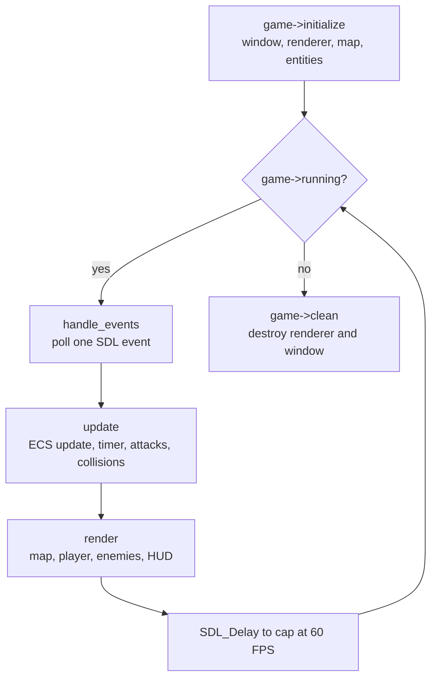
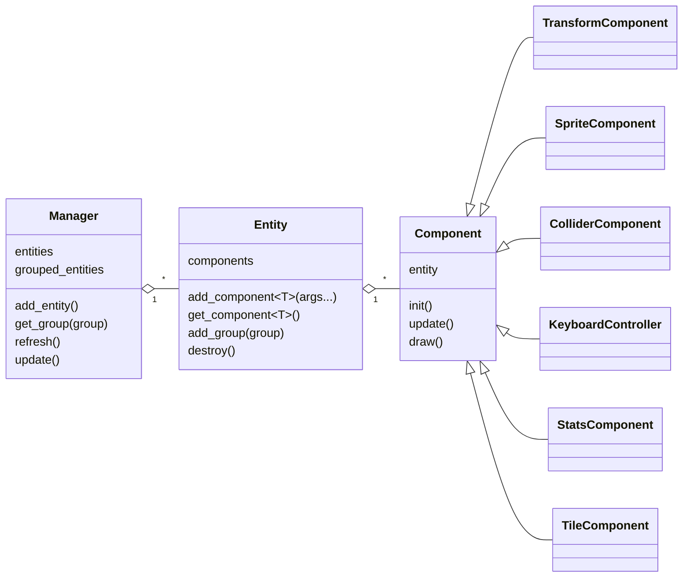

# 暈到咪咪冒冒小狗的下船大作戰！

A 2D bullet-dodging game in C++ with [SDL2](https://www.libsdl.org/).
This is the final project of Programming Design (2023).

Move the dog with W-A-S-D and dodge the enemy's bullets.
Survive for 50 seconds to win.

The code is built with reference to a YouTube tutorial series on SDL2 game development.
See [References](#references).

## Quick Start

Run all commands from this folder. The game loads `assets/` with relative paths.

### Linux / WSL

```bash
sudo apt install build-essential pkg-config libsdl2-dev
make
make run
```

On WSL, the game window opens through WSLg (Windows 11, or Windows 10 with WSLg).

### Windows (MinGW-w64)

```bat
mingw32-make
mingw32-make run
```

The SDL2 development files for MinGW are in `sdl2-mingw/`.
`SDL2.dll` must stay next to `main.exe`.

### Makefile Targets

| Target | Action |
|---|---|
| `make` | Build `main` (Linux) or `main.exe` (Windows). |
| `make run` | Build if necessary, then start the game. |
| `make clean` | Delete the executable. |

To use another SDL2 installation, set `SDL2_CFLAGS` and `SDL2_LIBS`:

```bash
make SDL2_CFLAGS="-I/opt/sdl2/include" SDL2_LIBS="-L/opt/sdl2/lib -lSDL2"
```

## How to Play

| Item | Rule |
|---|---|
| Move | Hold W, A, S, or D. A released key gives control back to the opposite key if it is still held. |
| Health | The player has 3 hearts. The hearts are on the right side of the window. |
| Damage | A hit costs 1 heart. Then the player is invincible for 2 seconds and shows the damaged sprite. |
| Victory | Survive until the timer reaches 50 seconds. |
| Game over | Lose all 3 hearts. |

The enemy stays at the top of the field. It uses three attacks.

| Attack | Period | Bullet speed (px/frame) | Behavior |
|---|---|---|---|
| Spread | Every 3 s | 3 | A fan of $\lfloor t/2 \rfloor$ bullets at time $t$. The fan grows over time. |
| Rebound | Every 15 s | 5 | One large bullet that bounces off the four walls. |
| Tracking | Every 30 s | 1.5 | One bullet that turns toward the player in every frame. |

When two periods meet (for example, at 15 s or 30 s), the attacks fire in the same frame.

## How the Program Works

### Game Loop

`main()` creates one `Game` object and runs a loop at a maximum of 60 frames per second.



`Game::update()` does these steps in each frame:

1. Remove destroyed entities (`manager.refresh()`), then update every component (`manager.update()`).
2. If the game has ended, stop here.
3. Once per second, advance `game_time`, count down the invincible time, and check for victory.
4. If the enemy's skill is ready, spawn the bullets of each attack whose period divides `game_time`.
5. Turn each tracking bullet toward the player.
6. Test every collider against the player and every enemy object with an AABB (axis-aligned bounding box) check. Push the player back from walls, apply damage, and bounce rebound bullets off walls.

### Entity Component System

The game uses an *entity component system* (ECS). An **entity** is an empty game object. A **component** gives an entity data or behavior. The **manager** owns all entities and sorts them into groups for drawing.



| Component | Role |
|---|---|
| `TransformComponent` | Position, velocity, size, scale, and speed. Moves the entity by `velocity * speed` in each frame. |
| `SpriteComponent` | Loads a BMP texture and draws it at the entity's position. |
| `ColliderComponent` | A rectangle and a tag string, such as `"Player"` or `"eWall"`. Registers itself in `Game::colliders`. |
| `KeyboardController` | Sets the player's velocity from W-A-S-D events. |
| `StatsComponent` | Health points, invincible time, and the enemy's skill cooldown. |
| `TileComponent` | One 32 × 32 background tile of the map. |

The entities belong to these groups. `Game::render()` draws them in this order.

| Group | Entities |
|---|---|
| `GROUP_MAP` | Background tiles and the four walls |
| `GROUP_PLAYERS` | The player |
| `GROUP_ENEMIES` | The enemy and all bullets |
| `GROUP_STATS_OBJECT` | The three hearts and the game-over or victory banner |

### Map

`assets/map.txt` is a 25 × 20 grid of comma-separated tile IDs. Each ID is one digit. ID `0` is the pink background tile. Each tile is 32 × 32 pixels, so the map covers 800 × 640 pixels. The file must use LF line endings, because the loader reads exactly one separator after each digit.

## Repository Layout

```
final-project/
├── main.cpp                  Entry point and frame loop. Includes every .cpp file.
├── game.h, game.cpp          Game class: setup, events, rules, rendering, cleanup.
├── map.h, map.cpp            Loads assets/map.txt into tiles.
├── texture_manager.h, .cpp   Loads BMP files and draws textures.
├── vector_2d.h, .cpp         2D vector math.
├── ecs/
│   ├── ecs.h, ecs.cpp        Component, Entity, and Manager.
│   ├── components.h          Includes all components.
│   ├── *_component.h         The components in the table above.
│   ├── keyboard_controller.h Player input.
│   └── collision.h, .cpp     AABB collision test.
├── assets/                   BMP sprites and map.txt.
├── sdl2-mingw/               SDL2 2.28.5 headers and libraries for MinGW (Windows only).
├── SDL2.dll                  SDL2 runtime for Windows.
└── Makefile
```

`main.cpp` includes every `.cpp` file, so the build compiles one file. This is a *single translation unit* build.

The third-party files keep their original names (`SDL2.dll`, `SDL_*.h`, `libSDL2*.a`). The compiler and the Windows loader look them up by these names.

## Code Style

- Functions and variables use snake case, such as `add_component` and `game_time`.
- Classes use Pascal case, such as `TransformComponent`.
- Constants and enum values use uppercase, such as `MAX_GROUPS` and `GROUP_MAP`.
- File names are lowercase snake case. Folder names are lowercase with `-`.
- Each `{` is on the same line as its declaration, loop, or condition.

## Known Issues

The refactor kept the original game logic. These issues are still in the code.

| Issue | Location | Effect |
|---|---|---|
| The rebound bullet's aim uses `player.x - enemy.y` for both axes. | `Game::update()` | The rebound bullet always starts at 45°, not toward the player. |
| A new bullet joins the collision test before its collider rectangle is set. | `Game::update()` | The test reads uninitialized values in the bullet's first frame. |
| `SpriteComponent::set_texture()` does not free the old texture. | `ecs/sprite_component.h` | The player sprite is reset every second, so one texture leaks each second. |
| `Game::handle_events()` polls only one event per frame. | `game.cpp` | Events queue up when several arrive in one frame. |
| Bullets that leave the field are never destroyed. | `Game::update()` | The number of entities grows during the game. |
| Only tile ID `0` has a texture. | `ecs/tile_component.h` | Another ID in `map.txt` leaves the texture path unset. |

### Fixes in This Refactor

Three changes were necessary to build and run the game. They do not change the game rules.

1. `ecs/transform_component.h` included `..\vector2D.h` with a backslash. Linux compilers do not accept it. The path now uses `/`.
2. `Game::clean()` destroyed the window before the renderer. `SDL_DestroyWindow` also frees the renderer, so the game crashed on every exit. The renderer is now destroyed first.
3. `Map::load_map()` called `atoi(&tile)` on a single `char`. This reads memory past the variable. The loader now uses `tile - '0'`, which gives the same ID.

## References

- **SDL2 game development tutorial (YouTube playlist)**: <https://www.youtube.com/watch?v=QQzAHcojEKg&list=PLhfAbcv9cehhkG7ZQK0nfIGJC_C-wSLrx>.
  The code of this game is built with reference to this series.
- **SDL2**: <https://www.libsdl.org/>.
